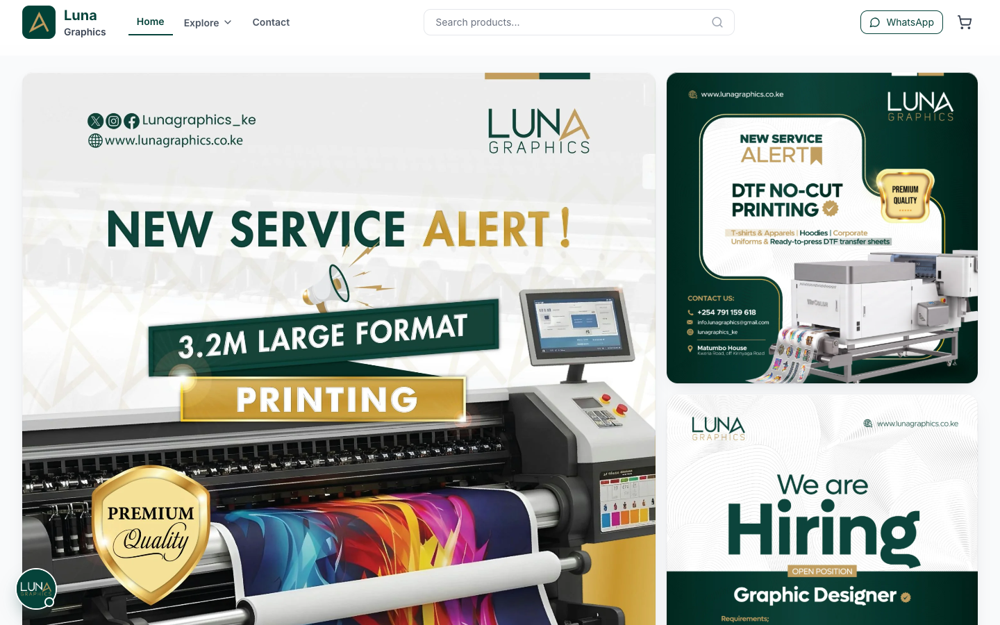
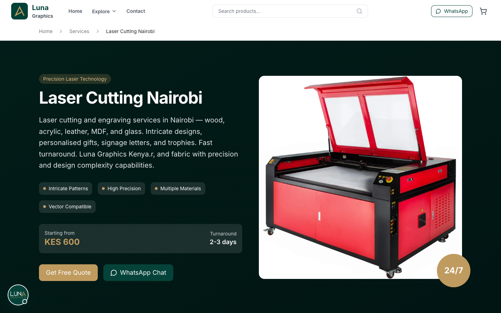
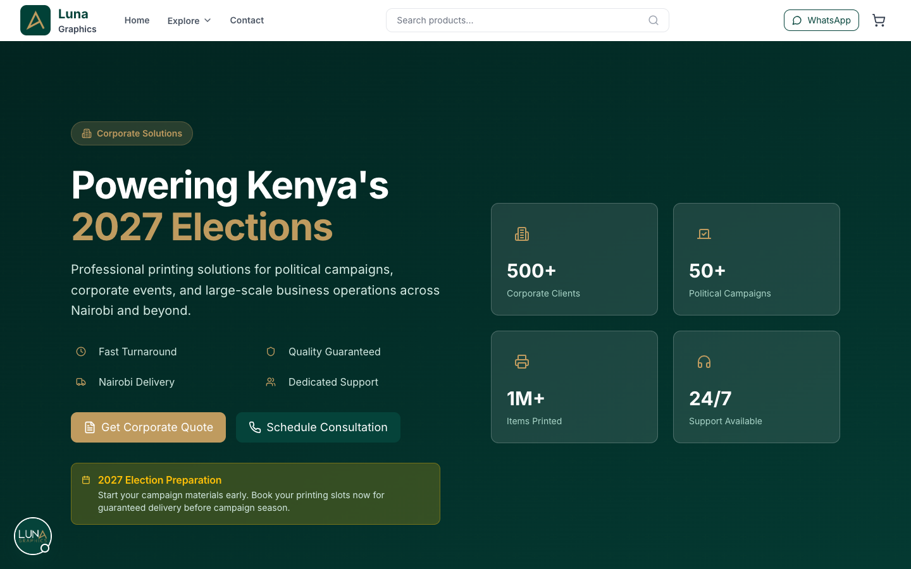
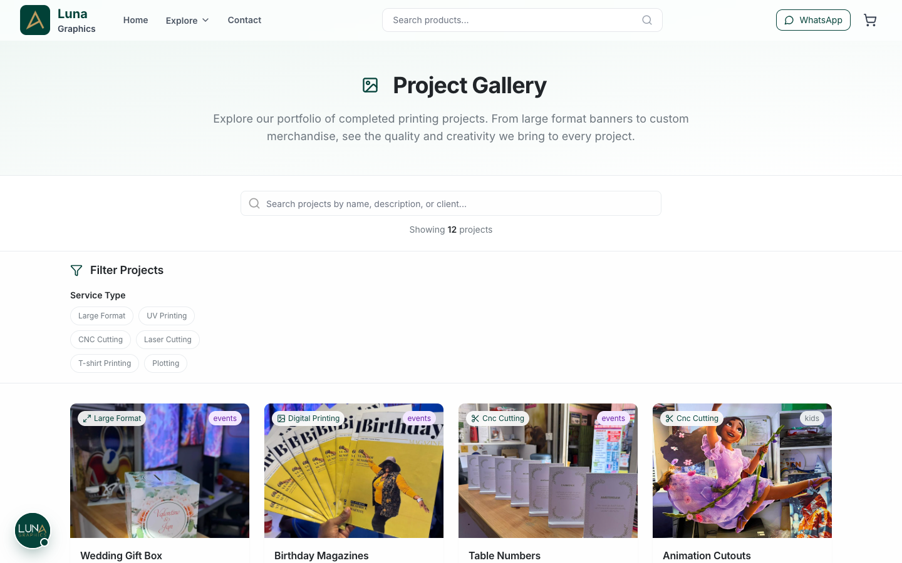
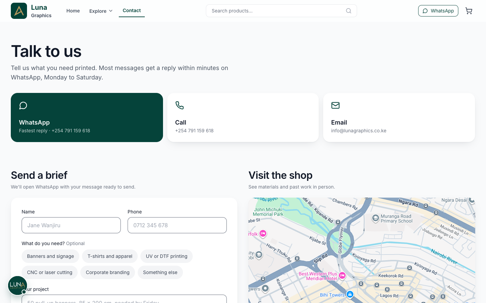
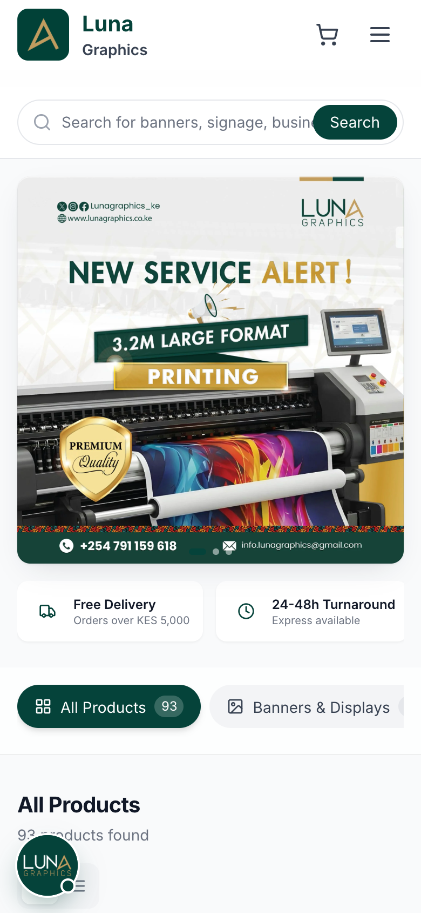

<div align="center">

# Luna Graphics

**Website and online shop for a Nairobi print and branding studio — large format, DTF, UV, laser and CNC, all in one place.**


</div>

<p align="center">
  
</p>

## Screenshots

| Service page | Corporate services |
| --- | --- |
|  |  |
| **Gallery** | **Contact** |
|  |  |

<p align="center"></p>

## Features

- **Service pages** for large format, plotting, UV, DTF, sublimation, digital and T-shirt printing, plus CNC and laser cutting, each with pricing, turnaround and a quote call-to-action.
- **Shop** with categories, product pages and a cart (React context).
- **Corporate desk**: events and exhibitions, corporate branding, corporate terms.
- **Gallery, team, blog, careers and FAQ** pages driven from data files in `src/data`.
- **Quote, contact and careers forms** sent through EmailJS; WhatsApp chat shortcut.
- **SEO built in**: per-page meta via `react-helmet-async`, generated sitemap, prerendered HTML for every route, link and SEO validators.
- Cookie consent with a “necessary only” option.

## Tech stack

| Area | Tools |
| --- | --- |
| UI | React 19, React Router 6, Tailwind CSS, Framer Motion, Astryx design system, Lucide icons |
| Forms | React Hook Form, EmailJS |
| Data and charts | Recharts, D3, date-fns |
| PDFs | jsPDF + AutoTable |
| Build | Vite 6, Puppeteer prerender |
| Hosting | Vercel |

## Getting started

### Prerequisites

- Node.js 20+ and npm

### Install and run

```bash
git clone https://github.com/Asta39/Luna-Graphics-.git
cd Luna-Graphics-
npm install
cp .env.example .env   # then fill in your own values
npm start              # http://localhost:4028
```

### Environment variables

Set these in `.env` (names only — never commit values):

| Variable | Purpose |
| --- | --- |
| `VITE_EMAILJS_SERVICE_ID`, `VITE_EMAILJS_TEMPLATE_ID`, `VITE_EMAILJS_PUBLIC_KEY` | Contact and quote forms |
| `VITE_CAREERS_EMAILJS_SERVICE_ID`, `VITE_CAREERS_EMAILJS_TEMPLATE_ID`, `VITE_CAREERS_EMAILJS_PUBLIC_KEY` | Careers application form |
| `VITE_CLOUDINARY_CLOUD_NAME`, `VITE_CLOUDINARY_UPLOAD_PRESET` | File uploads |
| `VITE_GOOGLE_ANALYTICS_ID` | Analytics |
| `VITE_GOOGLE_PLACES_API_KEY`, `VITE_GOOGLE_PLACES_ID`, `VITE_APP_REVIEWS_REFRESH_DAYS` | Google reviews |
| `VITE_SUPABASE_URL`, `VITE_SUPABASE_ANON_KEY`, `VITE_STRIPE_PUBLISHABLE_KEY`, `VITE_ADSENSE_ID` | Listed in `.env.example`; optional |

## Project structure

```
src/
  pages/        one folder per route (services, shop, cart, blog, careers…)
  components/   shared UI, SEO component, service and blog blocks
  data/         services, products, gallery, team, blog and FAQ content
  context/      cart state
  hooks/ utils/ styles/
scripts/        sitemap, prerender, link and SEO validators
public/         static assets and icons
```

## Scripts

| Command | What it does |
| --- | --- |
| `npm start` | Vite dev server on port 4028 |
| `npm run build` | Sitemap → Vite build → prerender every route into `build/` |
| `npm run build:smoke` | Quick build that prerenders only 10 routes |
| `npm run serve` | Preview the production build |
| `npm run validate:links` | Check internal links |
| `npm run validate:seo` | Check titles, descriptions and canonicals |
| `npm run puppeteer:install` | Install the Chrome used by the prerenderer |

## Deployment

Deployed on Vercel. `vercel.json` sets `build` as the output directory and holds the permanent redirects for old URLs. Add the environment variables above in the Vercel project settings; the build runs the prerender step so every page ships real HTML for search engines.

## License

No license file is included. All rights reserved by Luna Graphics.
